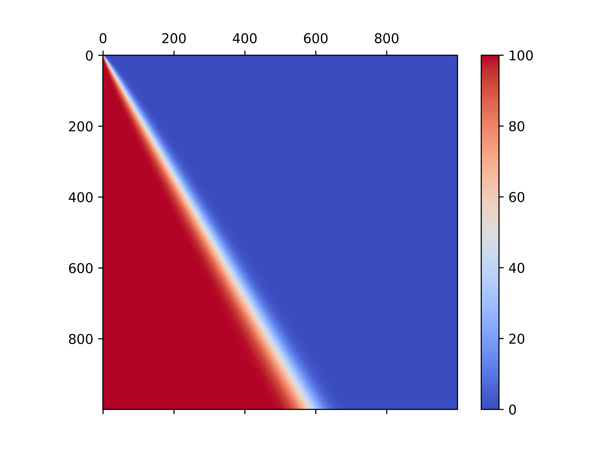

# Risiko Battle Probabilities

Computes the probability that an attacker with i armies defeats a defender with j armies in Risiko (Italian Risk, up to 3 dice per side, ties go to the defender). A single clash is solved exactly by enumerating all 6^(a+d) dice outcomes; the full battle is then a dynamic programme over (i, j): P(i, j) = sum over clash outcomes of P(outcome) * P(i - lost, j - lost), memoised in a table. The results are written to CSV and drawn as a heat map.

## How to run
Python 3 with `numpy` and `matplotlib`. In `Risiko.py` call `create_risiko_csv(n, "file.csv")` and `create_risiko_graph("file.csv", "picture")`; the examples at the bottom of the file show the 100x100 and 1000x1000 runs.

## Notes
- Rows are attackers, columns defenders; `Risiko100x100.png` includes the percentages in each cell.
- The 1000x1000 CSV (13 MB) is not included in the repository; the 40x40 and 100x100 tables are.
