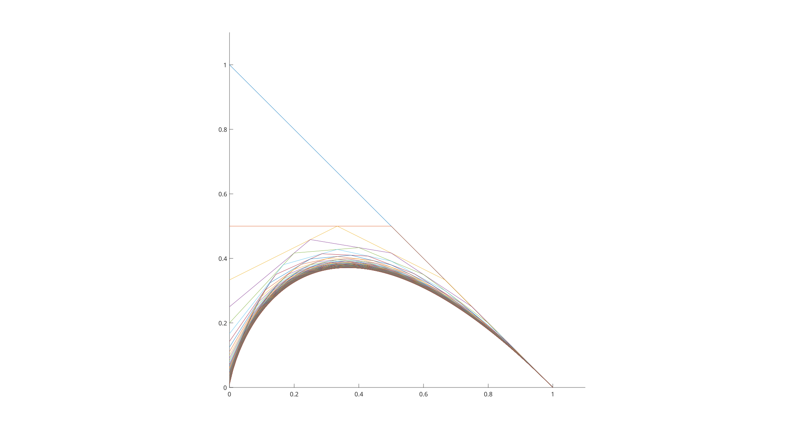

# Secretary Problem

MATLAB functions for the classical optimal-stopping problem: n candidates are seen in random order, the first k are rejected, and the next one better than all of them is chosen. `PSP(n, k)` evaluates the exact success probability (k/n) * sum_{i=k}^{n-1} 1/i; `PSPValues(n)` returns it for every k, and the live script plots the curves for n up to 100, showing the maximum tending to 1/e at k = n/e.

## How to run
MATLAB: add the folder to the path and run `verifiche.mlx`, or call `PSP(10, 3)` / `plot(1:n, PSPValues(n))` directly.

## Notes
- `PSP` also works with symbolic inputs (`sym`), giving exact rational probabilities.
